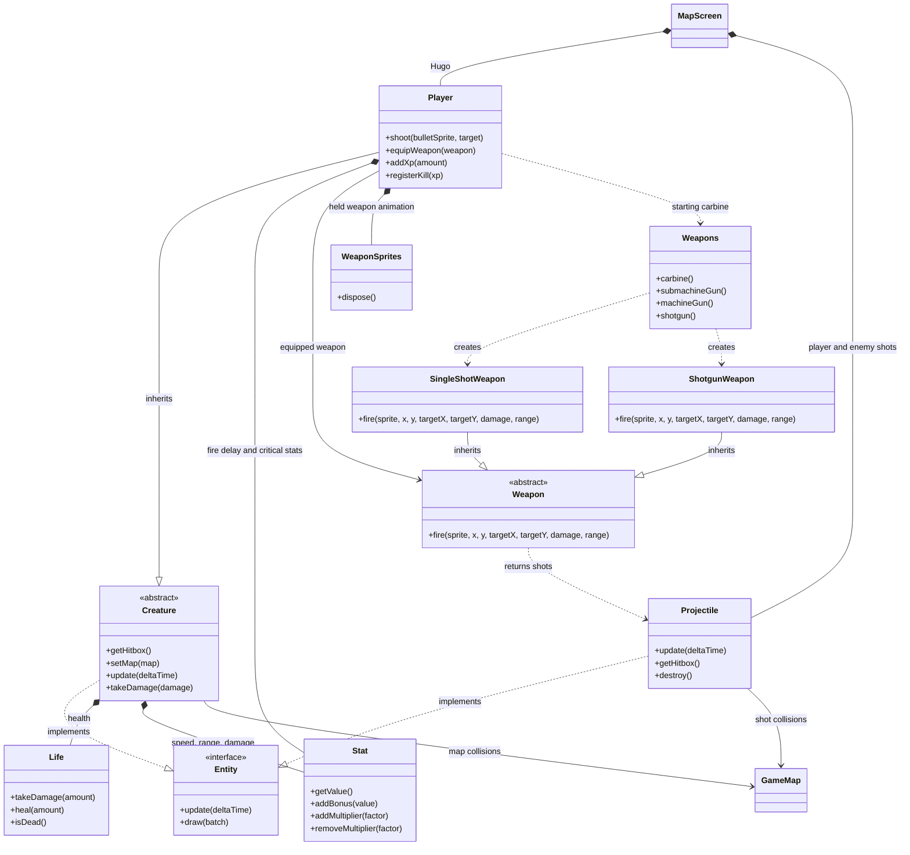
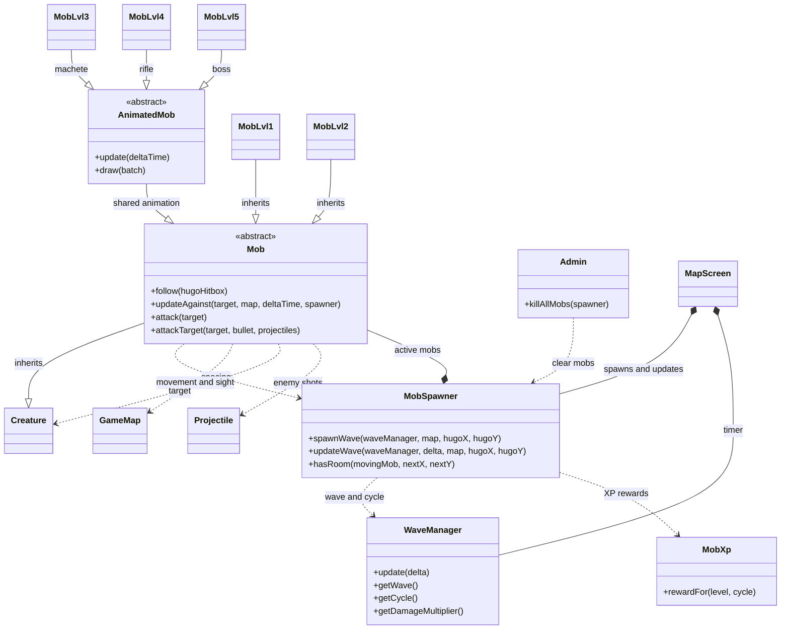
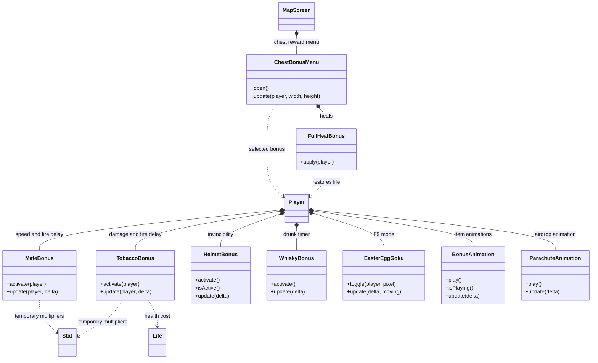
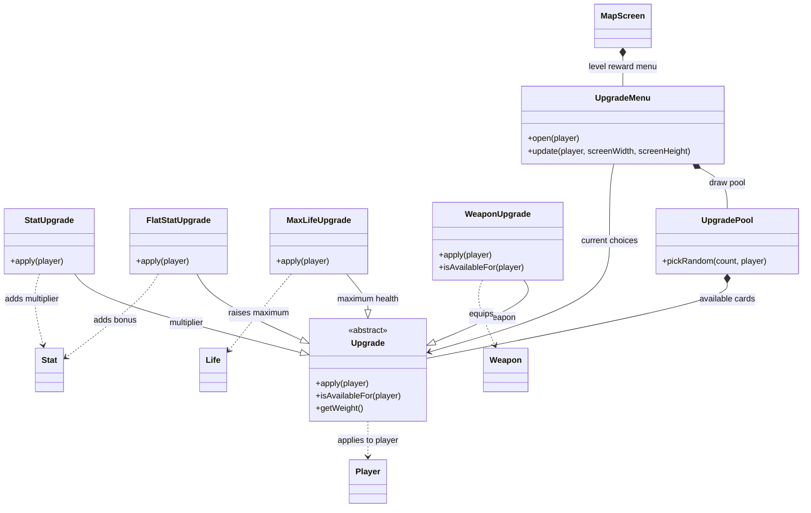

# Diagramme UML du Débarquement d’Hugo

Ce diagramme réunit le code actuel de Joël et de Thomas, y compris les armes, les bonus, l’XP et les menus. Les noms correspondent aux fichiers Java du dépôt. Les méthodes montrées sont une sélection pour comprendre les liens.

## Lire les symboles

| Symbole | Signification |
| --- | --- |
| `A --\|> B` | A hérite de B (`extends`). |
| `A ..\|> B` | A respecte l’interface B (`implements`). |
| `A *-- B` | A possède et gère B. |
| `A --> B` | A conserve une référence vers B. |
| `A ..> B` | A utilise B pendant une action. |
| `+` / `-` | Méthode ou champ public / privé. |
| `abstract` | Classe de base qui ne s’instancie pas directement. |
| `interface` | Liste de méthodes à respecter. |
| `enumeration` | Liste fixe de valeurs, par exemple les types de décor. |

## 1. Lancement, carte et affichage

Le lanceur démarre `HugoGame`. `StartGame` lit la cinématique puis ouvre `MapScreen`. `MapScreen` orchestre la partie, `GameMap` vérifie les déplacements et `MapRenderer` dessine. Le sol et les objets sont des couches de dessin du même monde ; les collisions utilisent les mêmes objets.

```mermaid
classDiagram
    direction TB
    class DesktopLauncher {
        +main(args)
    }
    class StartupHelper {
        +startNewJvmIfRequired()
    }
    class HugoGame {
        +create()
        +dispose()
    }
    class StartGame {
        +show()
        +render(delta)
    }
    class MapScreen {
        +show()
        +render(delta)
        +dispose()
    }
    class GameMap {
        +move(x, y, dx, dy)
        +canMove(position)
        +blocksShot(startX, startY, endX, endY)
        +updateChests(delta)
    }
    class MapCamera {
        +follow(targetX, targetY, screenWidth, screenHeight, worldWidth, worldHeight)
    }
    class MapRenderer {
        +draw(batch, camera, player, enemies)
        +drawCollisions(camera)
    }
    class DecorSprites {
        +get(type)
        +shadow(type)
        +dispose()
    }
    class DecorObject {
        +checkChestTrigger(nearby)
        +updateChest(delta)
        +reset()
    }
    class DecorType {
        <<enumeration>>
    }
    class MapArea {
        +contains(x, y)
        +intersects(box)
    }
    class GameOverMenu {
        +open(level, wave, kills)
        +update(screenWidth, screenHeight)
    }
    class XpBar {
        +draw(batch, pixel, font, player, screenHeight)
    }
    class HugoHealthBar {
        +draw(batch, pixel, life, centerX, y)
    }
    DesktopLauncher ..> StartupHelper : checks JVM
    DesktopLauncher ..> HugoGame : starts
    HugoGame --> StartGame : first screen
    StartGame ..> MapScreen : starts game
    MapScreen *-- GameMap : map
    MapScreen *-- MapCamera : camera
    MapScreen *-- MapRenderer : renderer
    MapScreen *-- XpBar : XP display
    MapScreen *-- GameOverMenu : retry menu
    MapRenderer --> GameMap : reads map
    MapRenderer *-- DecorSprites : sprite cache
    GameMap *-- DecorObject : objects
    GameMap *-- MapArea : areas
    DecorObject --> DecorType : type
    DecorSprites ..> DecorType : loads sprites
    Player ..> HugoHealthBar : draws health
    HugoGame --|> Game : libGDX
    StartGame --|> ScreenAdapter : libGDX
    MapScreen --|> ScreenAdapter : libGDX
```

## 2. Personnage, statistiques et armes

`Entity` impose `update` et `draw`. `Creature` partage la vie, les statistiques, la hitbox et les déplacements entre Hugo et les mobs. Les armes de Thomas créent les projectiles ; `WeaponSprites` choisit les images correspondantes dans les mains de Hugo.

## 3. Mobs, vagues et cycles

`Mob` calcule la direction vers Hugo, puis laisse `Creature.update` déplacer le mob. `MobSpawner` contrôle les positions et garde les survivants des anciennes vagues. `WaveManager` change de vague toutes les 25 secondes de jeu : après la vague 5, la vague 1 revient et le cycle augmente. Le multiplicateur de dégâts et celui de l’XP sont actuellement `1.2^(cycle - 1)`.

## 4. Coffres et bonus temporaires

`GameMap` appelle son écouteur quand un coffre finit de s’ouvrir. `MapScreen` ouvre alors `ChestBonusMenu`, qui tire trois cartes différentes et applique celle choisie. Les boosts et animations sont gérés par `Player`, pas par le décor. Le parachute passe par les demandes de `Player`, puis les mobs concernés sont retirés par `MobSpawner`.

## 5. XP et améliorations permanentes

Une élimination appelle `Player.registerKill`. `Player.addXp` augmente le niveau et le nombre de choix en attente. `UpgradeMenu` utilise `UpgradePool` pour tirer trois améliorations pondérées sans doublon. Une amélioration de statistique conserve le système `Stat` de Thomas ; une carte d’arme appelle `Player.equipWeapon`.

## Retrouver les fichiers

| Dossier | Contenu |
| --- | --- |
| [core/src/main/java/hugo/map](../core/src/main/java/hugo/map) | Carte, objets, caméra, collisions et dessin. |
| [core/src/main/java/hugo/entity](../core/src/main/java/hugo/entity) | Personnage, créatures, vie, statistiques et projectiles. |
| [core/src/main/java/hugo/weapon](../core/src/main/java/hugo/weapon) | Armes, paramètres de tir et dispersion du fusil à pompe. |
| [core/src/main/java/hugo/mob](../core/src/main/java/hugo/mob) | Comportement des cinq mobs, spawn et récompenses XP. |
| [core/src/main/java/hugo/wave](../core/src/main/java/hugo/wave) | Chronomètre, numéro de vague et cycle. |
| [core/src/main/java/hugo/bonus](../core/src/main/java/hugo/bonus) | Bonus et leurs animations. |
| [core/src/main/java/hugo/chest](../core/src/main/java/hugo/chest) | Choix aléatoire des cartes de coffre. |
| [core/src/main/java/hugo/upgrade](../core/src/main/java/hugo/upgrade) | Améliorations proposées au changement de niveau. |
| [core/src/main/java/hugo/startgame](../core/src/main/java/hugo/startgame) | Cinématique et menu Start. |
| [hugo/src/main/java/hugo/desktop](../hugo/src/main/java/hugo/desktop) | Point d’entrée du programme et aide au démarrage. |

## Classes utilitaires et tests

`FirstScreen` est le squelette fourni au démarrage du projet. Il n’est pas utilisé : `HugoGame.create()` choisit `StartGame`, ou directement `MapScreen` pour le test de lancement. `StartupHelper` est le code d’aide fourni pour le lanceur libGDX. `DecorSprites.GroundShadow` et `WeaponSprites.SpriteSheet` sont des classes internes qui rangent respectivement les textures d’ombres et celles d’une arme.

Les tests ne servent pas à jouer : ils vérifient qu’une modification n’a pas cassé une règle. Ils se trouvent dans `core/src/test/java` et se lancent avec `./gradlew core:check`.

| Test | Ce qu’il vérifie |
| --- | --- |
| `WorldTests` | Carte chargée, collisions, routes, ponts, coffres accessibles, fermeture et caméra. |
| `WeaponTests` | Nombre et direction des balles, dispersion, portée et valeurs des armes. |
| `UpgradePoolTests` | Tirage pondéré, absence de doublons et cartes indisponibles. |
| `WaveTests` | Délai de 25 secondes, vagues 1 à 5, cycles, temps restant et XP. |

Le lancement `./gradlew hugo:run --args=--smoke-test` vérifie aussi le rendu réel de la carte en ouvrant une fenêtre et en enregistrant trois captures.

## Renommages principaux

| Ancien nom | Nom actuel |
| --- | --- |
| `JeuHugo` | `HugoGame` |
| `EcranCarte` | `MapScreen` |
| `CarteJeu` | `GameMap` |
| `CameraCarte` | `MapCamera` |
| `RenduCarte` | `MapRenderer` |
| `ImagesDecor` | `DecorSprites` |
| `ObjetDecor` | `DecorObject` |
| `TypeDecor` | `DecorType` |
| `ZoneCarte` | `MapArea` |
| `hugo.Hugo_XP` | `hugo.xp` |
| `hugo.bureau.LanceurBureau` | `hugo.desktop.DesktopLauncher` |

Les chemins d’assets existants, par exemple `maps/carte.json`, restent compatibles. Les textes déjà dessinés dans des PNG et les dialogues de la vidéo conservent leur langue.
