# Diagramme UML du Débarquement d’Hugo

Un diagramme de classes UML montre les rôles des classes et leurs liens. Celui-ci présente les classes principales de la partie.

```mermaid
classDiagram
    direction TB

    class EcranCarte {
        +show()
        +render(delta)
    }
    class Player {
        +update(deltaTime)
        +shoot(bulletSprite, target)
        +registerKill(xp)
    }
    class Creature {
        <<abstract>>
        +getHitbox()
        +getLife()
    }
    class Mob {
        <<abstract>>
        +follow(hugoHitbox)
        +updateAgainst(target, map, deltaTime, spawner)
    }
    class MobSpawner {
        +spawnWave(waveManager, map, hugoX, hugoY)
        +updateWave(waveManager, delta, map, hugoX, hugoY)
    }
    class WaveManager {
        -int wave
        -int cycle
        +update(delta) bool
    }
    class CarteJeu {
        +move(x, y, dx, dy)
        +canMove(position) bool
    }
    class RenduCarte {
        +draw(batch, camera, player, enemies)
    }
    class ObjetDecor {
        +updateChest(delta) bool
    }
    class ChestBonusMenu {
        +open()
        +update(player, width, height)
    }
    class UpgradeMenu {
        +open()
        +update(player, screenWidth, screenHeight)
    }
    class Projectile {
        +update(deltaTime)
        +getHitbox()
    }
    class Life {
        +heal(amount)
        +takeDamage(amount)
    }
    class Stat {
        +getValue()
    }

    EcranCarte --> Player : met à jour
    EcranCarte --> WaveManager : conserve le chrono
    EcranCarte --> MobSpawner : déclenche les vagues
    EcranCarte --> RenduCarte : affiche le monde
    EcranCarte --> ChestBonusMenu : ouvre le menu du coffre
    EcranCarte --> UpgradeMenu : propose les améliorations
    RenduCarte --> CarteJeu : lit le décor
    CarteJeu "1" *-- "0..*" ObjetDecor : contient
    Creature <|-- Player
    Creature <|-- Mob
    Creature --> CarteJeu : teste les déplacements
    Creature "1" *-- "1" Life : possède
    Creature "1" *-- "3" Stat : stats de base
    MobSpawner "1" --> "0..*" Mob : gère
    MobSpawner ..> WaveManager : lit la vague et le cycle
    Mob ..> Player : poursuit Hugo
    Player ..> Projectile : crée
```

## Comment lire les flèches

- Le triangle pointe vers la classe parente. `Player` et `Mob` héritent de `Creature`.
- Une flèche simple signale un lien entre deux classes. `EcranCarte` se sert de `RenduCarte` pour dessiner le monde.
- Le losange plein indique un objet qui en possède d’autres. `CarteJeu` contient ses objets du décor.
- Les pointillés indiquent qu’une classe utilise l’autre pour une action. `Mob` utilise la position de Hugo pour le poursuivre.
- `0..*` signifie « zéro ou plusieurs ». `+` indique une méthode publique et `-` un champ privé.
